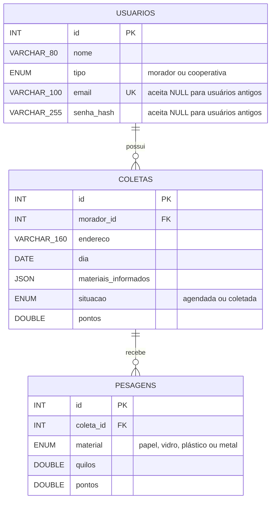

# Diagrama de entidades e relacionamentos

Estrutura dos modelos SQLAlchemy na revisão `0003_limites_cartilha`.

- Cada coleta pertence a um usuário; o serviço garante o perfil morador e usa o id do token.
- Cada pesagem pertence a uma coleta existente; coletas sem pesagem são permitidas.
- Materiais informados ficam em JSON, sem quarta entidade ou geração de pontos.
- O serviço calcula papel 1, vidro 1, plástico 2 e metal 4 pontos/kg. A pesagem guarda o resultado; a coleta, o total.
- Peso positivo, pontos não negativos e situação inicial agendada. Não há teto de peso ou quantidade de materiais informados.
- Pesagem e total são gravados juntos, com bloqueio da coleta para preservar a soma concorrente.
- E-mail único; NULL preserva usuários antigos. Senhas legíveis não fazem parte das tabelas.
- Índices por dia/morador nas coletas e por coleta nas pesagens. Chaves estrangeiras sem exclusão em cascata.

O módulo de IA planejado não exige tabela nova no MVP.
