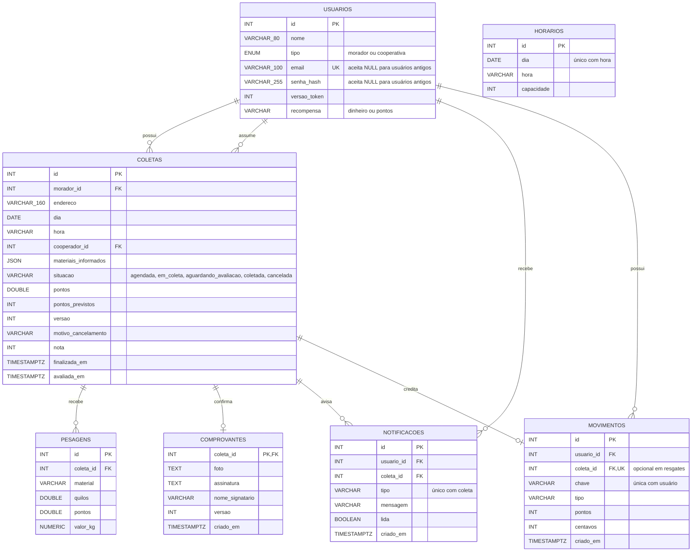

# Diagrama de entidades e relacionamentos

Estrutura PostgreSQL após `20261029023257_fluxo_coletas_recompensas`. As tabelas originais foram preservadas e ampliadas.

- Cada coleta pertence a um usuário; o serviço garante o perfil morador e usa o id do token.
- Cada pesagem pertence a uma coleta existente; coletas sem pesagem são permitidas.
- Materiais informados ficam em JSON e não geram crédito. O serviço registra tarifa por pesagem e calcula a previsão com Decimal; a avaliação libera o total arredondado.
- O extrato usa inteiros para pontos/centavos. O histórico DOUBLE foi preservado; não há conversão retroativa automática.
- Bloqueios serializam reservas de horário, alterações da coleta e movimentos da carteira. A unicidade do crédito por coleta impede dupla recompensa.
- Foto e assinatura ficam em tabela privada; a listagem de coletas não carrega imagens. As sete tabelas têm RLS.
- E-mail único; NULL preserva usuários antigos. Senhas legíveis não fazem parte das tabelas.
- Índices por dia/morador nas coletas e por coleta nas pesagens. Chaves estrangeiras sem exclusão em cascata.

O módulo de IA planejado não exige tabela nova no MVP.
